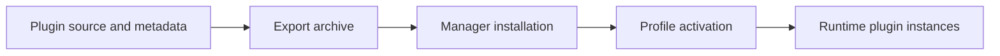
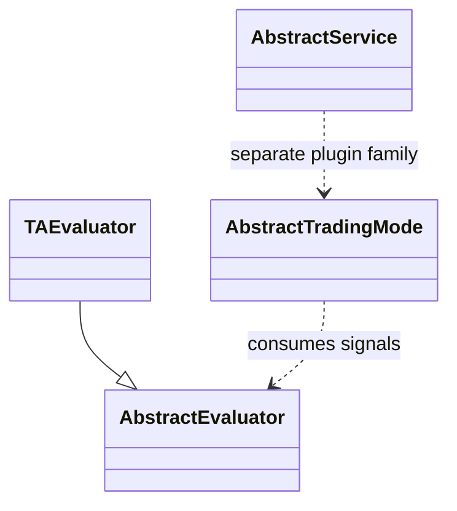
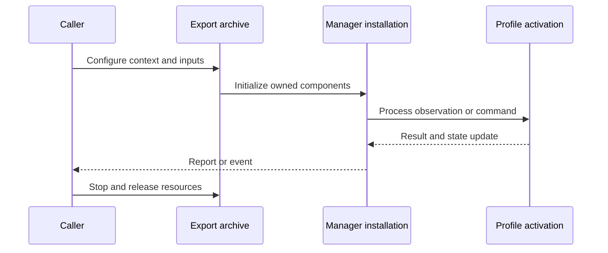
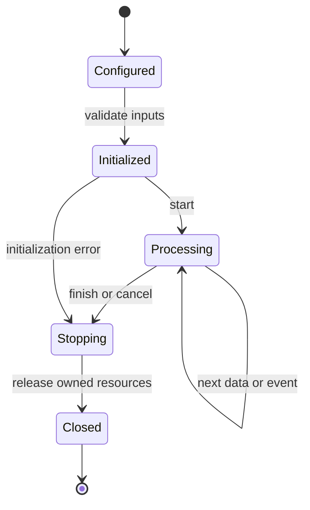
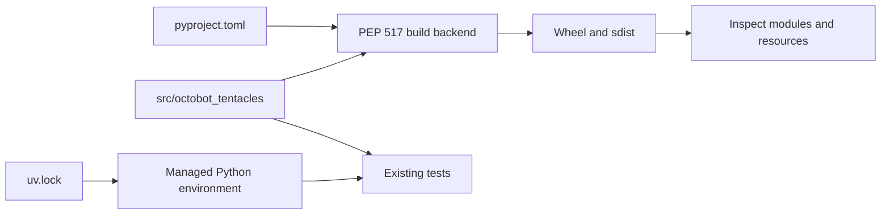
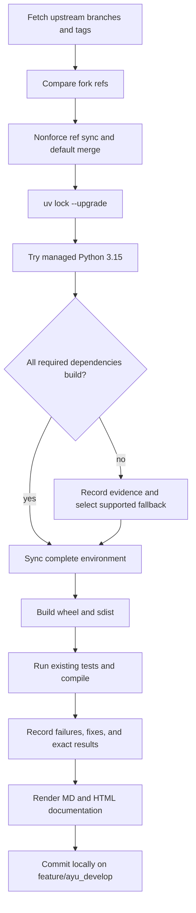

# OctoBot-Tentacles: architecture and development

Tentacles is an archive of OctoBot plugins: evaluators, trading modes, exchange adapters, service feeds/interfaces, scripted keywords, and profiles. The archive directory is the source tree; Tentacles Manager generates the runtime tentacles namespace during installation.

## Components and boundaries

Each plugin group carries Python code, metadata, default configuration, documentation, and optional static assets. Plugin classes inherit public OctoBot evaluator/trading/service bases. Metadata declares discovery/build requirements; the manager packages and installs selected plugins. Scripting keywords compose trading/data operations without duplicating exchange/account implementations.

The following class view names implementation classes. Cross-package types are supplied by the host ecosystem; arrows describe inheritance or usage, not copied ownership.

## Runtime workflow

Select the plugin source folder, export a platform archive with metadata/resources, install it through Tentacles Manager, load profile activation, discover plugin classes, create their runtime instances, and process channel events. UI/service plugins expose control and reporting surfaces, while trading plugins submit orders through Trading.

This sequence is an architectural view of responsibility and resource ownership. Individual plugin, connector, and strategy implementations can add asynchronous events and error branches. The lifecycle below is a conceptual operating workflow, rather than a claim that every component has one shared state enum.

## Features and extension points

Technical/social/strategy evaluators; daily and specialized trading modes; exchange adapters; web and notification interfaces; remote/service feeds; strategy scripting keywords; profile templates.

Extend the owning component behind its existing public interface. Keep metadata and configuration alongside plugin/strategy resources. Exchange-specific behavior belongs in an adapter; strategy decisions belong in the strategy/evaluator layer; persistence schema and migrations belong with the storage implementation. Review the source map below before changing a boundary, and exercise the existing tests associated with that boundary.

## Packaging and dependency design

This source package is not interchangeable with the generated tentacles import namespace. The newer plugins embedded in OctoBot/packages/tentacles and this standalone archive can target different ecosystem versions. Existing plugin tests must run against an installed compatible archive; compile/build checks alone cannot establish trading behavior.

The lock records exact package versions, hashes, platform markers, and local source mappings. Path sources deliberately bind related repositories in this workspace; clone sibling repositories at the documented names before synchronization. Published packaging metadata describes public dependencies, while uv source settings select this development workspace. Resolve dependency changes with uv lock --upgrade and retain the generated lock, then verify the same locked environment.

## Maintenance workflow

All upstream branches and tags are fetched. Fork updates use nonforce pushes; a divergent branch is merged without erasing fork history. The default branch is merged into feature/ayu_develop with package/resource conflicts reconciled in their installed locations. Build and test evidence is recorded before a local maintenance commit. Feature branch publication is a separate root-level action.

No existing test assertions are removed and no new test cases are introduced in this maintenance pass. Corrected fixtures preserve coverage while making paths, corruption inputs, and resource cleanup compatible with the selected interpreter. A failed test or unsupported dependency is reported explicitly in [validation](validation.md); package build success does not imply strategy correctness, profitability, or successful live connectivity.

## Source map

| Source | Responsibility and location |
| --- | --- |
| [momentum.py](../src/octobot_tentacles/Evaluator/TA/momentum_evaluator/momentum.py) | src/octobot_tentacles/Evaluator/TA/momentum_evaluator/momentum.py |
| [volatility.py](../src/octobot_tentacles/Evaluator/TA/volatility_evaluator/volatility.py) | src/octobot_tentacles/Evaluator/TA/volatility_evaluator/volatility.py |
| [ai.py](../src/octobot_tentacles/Evaluator/TA/ai_evaluator/ai.py) | src/octobot_tentacles/Evaluator/TA/ai_evaluator/ai.py |
| [trend.py](../src/octobot_tentacles/Evaluator/TA/trend_evaluator/trend.py) | src/octobot_tentacles/Evaluator/TA/trend_evaluator/trend.py |
| [mixed_strategies.py](../src/octobot_tentacles/Evaluator/Strategies/mixed_strategies_evaluator/mixed_strategies.py) | src/octobot_tentacles/Evaluator/Strategies/mixed_strategies_evaluator/mixed_strategies.py |
| [move_signals_strategy.py](../src/octobot_tentacles/Evaluator/Strategies/move_signals_strategy_evaluator/move_signals_strategy.py) | src/octobot_tentacles/Evaluator/Strategies/move_signals_strategy_evaluator/move_signals_strategy.py |
| [dip_analyser_strategy.py](../src/octobot_tentacles/Evaluator/Strategies/dip_analyser_strategy_evaluator/dip_analyser_strategy.py) | src/octobot_tentacles/Evaluator/Strategies/dip_analyser_strategy_evaluator/dip_analyser_strategy.py |
| [blank_strategy.py](../src/octobot_tentacles/Evaluator/Strategies/blank_strategy_evaluator/blank_strategy.py) | src/octobot_tentacles/Evaluator/Strategies/blank_strategy_evaluator/blank_strategy.py |
| [blank_trading.py](../src/octobot_tentacles/Trading/Mode/blank_trading_mode/blank_trading.py) | src/octobot_tentacles/Trading/Mode/blank_trading_mode/blank_trading.py |
| [signal_trading.py](../src/octobot_tentacles/Trading/Mode/signal_trading_mode/signal_trading.py) | src/octobot_tentacles/Trading/Mode/signal_trading_mode/signal_trading.py |
| [reference_price.py](../src/octobot_tentacles/Trading/Mode/market_making_trading_mode/reference_price.py) | src/octobot_tentacles/Trading/Mode/market_making_trading_mode/reference_price.py |
| [market_making_trading.py](../src/octobot_tentacles/Trading/Mode/market_making_trading_mode/market_making_trading.py) | src/octobot_tentacles/Trading/Mode/market_making_trading_mode/market_making_trading.py |
| [order_book_distribution.py](../src/octobot_tentacles/Trading/Mode/market_making_trading_mode/order_book_distribution.py) | src/octobot_tentacles/Trading/Mode/market_making_trading_mode/order_book_distribution.py |
| [index_distribution.py](../src/octobot_tentacles/Trading/Mode/index_trading_mode/index_distribution.py) | src/octobot_tentacles/Trading/Mode/index_trading_mode/index_distribution.py |
| [pyproject.toml](../pyproject.toml) | pyproject.toml |
| [uv.lock](../uv.lock) | uv.lock |
| [README.md](../README.md) | README.md |

## Further reading

Use [development.md](development.md) for reproducible commands and [validation.md](validation.md) for exact interpreter, dependency, build, test, and blocker evidence. The equivalent [HTML architecture document](ayu-develop.html) supports browsing and rendered diagrams.
