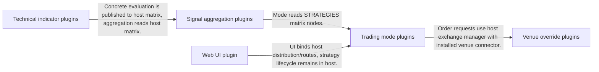
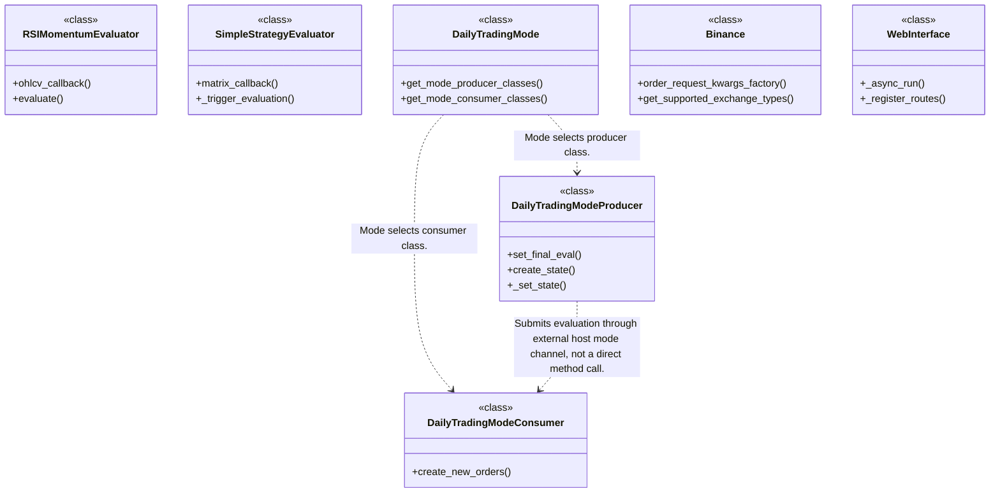
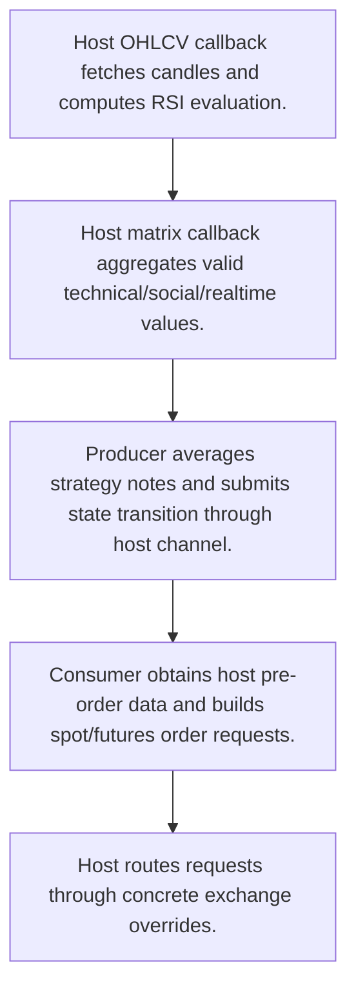
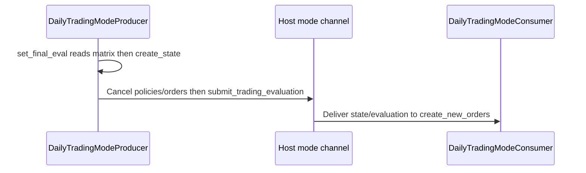

# OctoBot-Tentacles: workflow, design and architecture

Updated: **2026-10-13**
Reviewed Git hash: `54b3948ffc13afd2291c5764435887b4257666be`
Branch: `feature/ayu_develop`
Source diff SHA256: `e3b0c44298fc1c149afbf4c8996fb92427ae41e4649b934ca495991b7852b855`
Scope: **Strategy / exchange / UI plugin bundle** / Maintenance: **companion**
Languages: Python, JavaScript

[HTML edition](ayu-develop.html) / [Development](development.md) / [Historical validation](validation.md) / [Full system comparison](../../docs/index.html)

## Purpose and scope

Provide concrete indicator evaluators, strategy aggregation, order-producing trading modes, venue overrides and web interfaces installed into OctoBot.

## Features and support boundaries

Native = implemented here. Integration = supplied through a named host/API. Limited = material restriction. Not provided = evidenced scope exclusion. Unverified = support/absence not established. Not applicable = outside this artifact type.

| Capability | Status | Implementation and limits | Source |
|---|---|---|---|
| Backtesting | Limited | Some modes integrate host replay, but MarketMakingTradingMode.is_backtestable explicitly returns false. | [MarketMakingTradingMode.is_backtestable](../src/octobot_tentacles/Trading/Mode/market_making_trading_mode/market_making_trading.py) ([L237](https://github.com/alexcwyu/OctoBot-Tentacles/blob/54b3948ffc13afd2291c5764435887b4257666be/src/octobot_tentacles/Trading/Mode/market_making_trading_mode/market_making_trading.py#L237)) / [DailyTradingModeConsumer.create_new_orders](../src/octobot_tentacles/Trading/Mode/daily_trading_mode/daily_trading.py) ([L548](https://github.com/alexcwyu/OctoBot-Tentacles/blob/54b3948ffc13afd2291c5764435887b4257666be/src/octobot_tentacles/Trading/Mode/daily_trading_mode/daily_trading.py#L548)) |
| Live execution | Integration | Requires OctoBot host, Trading/Evaluators/data packages; venue plugin supplies Binance overrides and spot/futures declaration. | [DailyTradingModeConsumer.create_new_orders](../src/octobot_tentacles/Trading/Mode/daily_trading_mode/daily_trading.py) ([L548](https://github.com/alexcwyu/OctoBot-Tentacles/blob/54b3948ffc13afd2291c5764435887b4257666be/src/octobot_tentacles/Trading/Mode/daily_trading_mode/daily_trading.py#L548)) / [Binance.order_request_kwargs_factory](../src/octobot_tentacles/Trading/Exchange/binance/binance_exchange.py) ([L290](https://github.com/alexcwyu/OctoBot-Tentacles/blob/54b3948ffc13afd2291c5764435887b4257666be/src/octobot_tentacles/Trading/Exchange/binance/binance_exchange.py#L290)) / [Binance.get_supported_exchange_types](../src/octobot_tentacles/Trading/Exchange/binance/binance_exchange.py) ([L235](https://github.com/alexcwyu/OctoBot-Tentacles/blob/54b3948ffc13afd2291c5764435887b4257666be/src/octobot_tentacles/Trading/Exchange/binance/binance_exchange.py#L235)) |
| Paper trading | Integration | Requires OctoBot host, Trading/Evaluators/data packages; venue plugin supplies Binance overrides and spot/futures declaration. | [DailyTradingModeConsumer.create_new_orders](../src/octobot_tentacles/Trading/Mode/daily_trading_mode/daily_trading.py) ([L548](https://github.com/alexcwyu/OctoBot-Tentacles/blob/54b3948ffc13afd2291c5764435887b4257666be/src/octobot_tentacles/Trading/Mode/daily_trading_mode/daily_trading.py#L548)) / [Binance.order_request_kwargs_factory](../src/octobot_tentacles/Trading/Exchange/binance/binance_exchange.py) ([L290](https://github.com/alexcwyu/OctoBot-Tentacles/blob/54b3948ffc13afd2291c5764435887b4257666be/src/octobot_tentacles/Trading/Exchange/binance/binance_exchange.py#L290)) / [Binance.get_supported_exchange_types](../src/octobot_tentacles/Trading/Exchange/binance/binance_exchange.py) ([L235](https://github.com/alexcwyu/OctoBot-Tentacles/blob/54b3948ffc13afd2291c5764435887b4257666be/src/octobot_tentacles/Trading/Exchange/binance/binance_exchange.py#L235)) |
| Event driven | Integration | Concrete native plugin implementations subclass host evaluator/mode APIs; runtime lifecycle/channels are host supplied. | [RSIMomentumEvaluator.evaluate](../src/octobot_tentacles/Evaluator/TA/momentum_evaluator/momentum.py) ([L103](https://github.com/alexcwyu/OctoBot-Tentacles/blob/54b3948ffc13afd2291c5764435887b4257666be/src/octobot_tentacles/Evaluator/TA/momentum_evaluator/momentum.py#L103)) / [SimpleStrategyEvaluator._trigger_evaluation](../src/octobot_tentacles/Evaluator/Strategies/mixed_strategies_evaluator/mixed_strategies.py) ([L132](https://github.com/alexcwyu/OctoBot-Tentacles/blob/54b3948ffc13afd2291c5764435887b4257666be/src/octobot_tentacles/Evaluator/Strategies/mixed_strategies_evaluator/mixed_strategies.py#L132)) / [DailyTradingMode.get_mode_producer_classes](../src/octobot_tentacles/Trading/Mode/daily_trading_mode/daily_trading.py) ([L179](https://github.com/alexcwyu/OctoBot-Tentacles/blob/54b3948ffc13afd2291c5764435887b4257666be/src/octobot_tentacles/Trading/Mode/daily_trading_mode/daily_trading.py#L179)) / [DailyTradingModeProducer._set_state](../src/octobot_tentacles/Trading/Mode/daily_trading_mode/daily_trading.py) ([L1048](https://github.com/alexcwyu/OctoBot-Tentacles/blob/54b3948ffc13afd2291c5764435887b4257666be/src/octobot_tentacles/Trading/Mode/daily_trading_mode/daily_trading.py#L1048)) |
| Vectorized | Unverified | Representative source review did not establish this capability; no claim of absence. | Not applicable to this repository scope. |
| Order management | Integration | Requires OctoBot host, Trading/Evaluators/data packages; venue plugin supplies Binance overrides and spot/futures declaration. | [DailyTradingModeConsumer.create_new_orders](../src/octobot_tentacles/Trading/Mode/daily_trading_mode/daily_trading.py) ([L548](https://github.com/alexcwyu/OctoBot-Tentacles/blob/54b3948ffc13afd2291c5764435887b4257666be/src/octobot_tentacles/Trading/Mode/daily_trading_mode/daily_trading.py#L548)) / [Binance.order_request_kwargs_factory](../src/octobot_tentacles/Trading/Exchange/binance/binance_exchange.py) ([L290](https://github.com/alexcwyu/OctoBot-Tentacles/blob/54b3948ffc13afd2291c5764435887b4257666be/src/octobot_tentacles/Trading/Exchange/binance/binance_exchange.py#L290)) / [Binance.get_supported_exchange_types](../src/octobot_tentacles/Trading/Exchange/binance/binance_exchange.py) ([L235](https://github.com/alexcwyu/OctoBot-Tentacles/blob/54b3948ffc13afd2291c5764435887b4257666be/src/octobot_tentacles/Trading/Exchange/binance/binance_exchange.py#L235)) |
| Order types | Native | Daily mode creates crypto order requests with target-profit/stop settings and spot/futures sizing; host executes them. | [DailyTradingModeConsumer.create_new_orders](../src/octobot_tentacles/Trading/Mode/daily_trading_mode/daily_trading.py) ([L548](https://github.com/alexcwyu/OctoBot-Tentacles/blob/54b3948ffc13afd2291c5764435887b4257666be/src/octobot_tentacles/Trading/Mode/daily_trading_mode/daily_trading.py#L548)) / [DailyTradingModeProducer._set_state](../src/octobot_tentacles/Trading/Mode/daily_trading_mode/daily_trading.py) ([L1048](https://github.com/alexcwyu/OctoBot-Tentacles/blob/54b3948ffc13afd2291c5764435887b4257666be/src/octobot_tentacles/Trading/Mode/daily_trading_mode/daily_trading.py#L1048)) |
| Multi venue | Integration | Requires OctoBot host, Trading/Evaluators/data packages; venue plugin supplies Binance overrides and spot/futures declaration. | [DailyTradingModeConsumer.create_new_orders](../src/octobot_tentacles/Trading/Mode/daily_trading_mode/daily_trading.py) ([L548](https://github.com/alexcwyu/OctoBot-Tentacles/blob/54b3948ffc13afd2291c5764435887b4257666be/src/octobot_tentacles/Trading/Mode/daily_trading_mode/daily_trading.py#L548)) / [Binance.order_request_kwargs_factory](../src/octobot_tentacles/Trading/Exchange/binance/binance_exchange.py) ([L290](https://github.com/alexcwyu/OctoBot-Tentacles/blob/54b3948ffc13afd2291c5764435887b4257666be/src/octobot_tentacles/Trading/Exchange/binance/binance_exchange.py#L290)) / [Binance.get_supported_exchange_types](../src/octobot_tentacles/Trading/Exchange/binance/binance_exchange.py) ([L235](https://github.com/alexcwyu/OctoBot-Tentacles/blob/54b3948ffc13afd2291c5764435887b4257666be/src/octobot_tentacles/Trading/Exchange/binance/binance_exchange.py#L235)) |
| Crypto | Native | Daily mode creates crypto order requests with target-profit/stop settings and spot/futures sizing; host executes them. | [DailyTradingModeConsumer.create_new_orders](../src/octobot_tentacles/Trading/Mode/daily_trading_mode/daily_trading.py) ([L548](https://github.com/alexcwyu/OctoBot-Tentacles/blob/54b3948ffc13afd2291c5764435887b4257666be/src/octobot_tentacles/Trading/Mode/daily_trading_mode/daily_trading.py#L548)) / [DailyTradingModeProducer._set_state](../src/octobot_tentacles/Trading/Mode/daily_trading_mode/daily_trading.py) ([L1048](https://github.com/alexcwyu/OctoBot-Tentacles/blob/54b3948ffc13afd2291c5764435887b4257666be/src/octobot_tentacles/Trading/Mode/daily_trading_mode/daily_trading.py#L1048)) |
| Equities | Unverified | Representative source review did not establish this capability; no claim of absence. | Not applicable to this repository scope. |
| Futures | Integration | Requires OctoBot host, Trading/Evaluators/data packages; venue plugin supplies Binance overrides and spot/futures declaration. | [DailyTradingModeConsumer.create_new_orders](../src/octobot_tentacles/Trading/Mode/daily_trading_mode/daily_trading.py) ([L548](https://github.com/alexcwyu/OctoBot-Tentacles/blob/54b3948ffc13afd2291c5764435887b4257666be/src/octobot_tentacles/Trading/Mode/daily_trading_mode/daily_trading.py#L548)) / [Binance.order_request_kwargs_factory](../src/octobot_tentacles/Trading/Exchange/binance/binance_exchange.py) ([L290](https://github.com/alexcwyu/OctoBot-Tentacles/blob/54b3948ffc13afd2291c5764435887b4257666be/src/octobot_tentacles/Trading/Exchange/binance/binance_exchange.py#L290)) / [Binance.get_supported_exchange_types](../src/octobot_tentacles/Trading/Exchange/binance/binance_exchange.py) ([L235](https://github.com/alexcwyu/OctoBot-Tentacles/blob/54b3948ffc13afd2291c5764435887b4257666be/src/octobot_tentacles/Trading/Exchange/binance/binance_exchange.py#L235)) |
| Options | Unverified | Representative source review did not establish this capability; no claim of absence. | Not applicable to this repository scope. |
| Forex | Unverified | Representative source review did not establish this capability; no claim of absence. | Not applicable to this repository scope. |
| Strategy api | Integration | Concrete native plugin implementations subclass host evaluator/mode APIs; runtime lifecycle/channels are host supplied. | [RSIMomentumEvaluator.evaluate](../src/octobot_tentacles/Evaluator/TA/momentum_evaluator/momentum.py) ([L103](https://github.com/alexcwyu/OctoBot-Tentacles/blob/54b3948ffc13afd2291c5764435887b4257666be/src/octobot_tentacles/Evaluator/TA/momentum_evaluator/momentum.py#L103)) / [SimpleStrategyEvaluator._trigger_evaluation](../src/octobot_tentacles/Evaluator/Strategies/mixed_strategies_evaluator/mixed_strategies.py) ([L132](https://github.com/alexcwyu/OctoBot-Tentacles/blob/54b3948ffc13afd2291c5764435887b4257666be/src/octobot_tentacles/Evaluator/Strategies/mixed_strategies_evaluator/mixed_strategies.py#L132)) / [DailyTradingMode.get_mode_producer_classes](../src/octobot_tentacles/Trading/Mode/daily_trading_mode/daily_trading.py) ([L179](https://github.com/alexcwyu/OctoBot-Tentacles/blob/54b3948ffc13afd2291c5764435887b4257666be/src/octobot_tentacles/Trading/Mode/daily_trading_mode/daily_trading.py#L179)) / [DailyTradingModeProducer._set_state](../src/octobot_tentacles/Trading/Mode/daily_trading_mode/daily_trading.py) ([L1048](https://github.com/alexcwyu/OctoBot-Tentacles/blob/54b3948ffc13afd2291c5764435887b4257666be/src/octobot_tentacles/Trading/Mode/daily_trading_mode/daily_trading.py#L1048)) |
| Optimization | Unverified | Representative source review did not establish this capability; no claim of absence. | Not applicable to this repository scope. |
| Machine learning | Unverified | Representative source review did not establish this capability; no claim of absence. | Not applicable to this repository scope. |
| Reinforcement learning | Unverified | Representative source review did not establish this capability; no claim of absence. | Not applicable to this repository scope. |
| Portfolio | Integration | Requires OctoBot host, Trading/Evaluators/data packages; venue plugin supplies Binance overrides and spot/futures declaration. | [DailyTradingModeConsumer.create_new_orders](../src/octobot_tentacles/Trading/Mode/daily_trading_mode/daily_trading.py) ([L548](https://github.com/alexcwyu/OctoBot-Tentacles/blob/54b3948ffc13afd2291c5764435887b4257666be/src/octobot_tentacles/Trading/Mode/daily_trading_mode/daily_trading.py#L548)) / [Binance.order_request_kwargs_factory](../src/octobot_tentacles/Trading/Exchange/binance/binance_exchange.py) ([L290](https://github.com/alexcwyu/OctoBot-Tentacles/blob/54b3948ffc13afd2291c5764435887b4257666be/src/octobot_tentacles/Trading/Exchange/binance/binance_exchange.py#L290)) / [Binance.get_supported_exchange_types](../src/octobot_tentacles/Trading/Exchange/binance/binance_exchange.py) ([L235](https://github.com/alexcwyu/OctoBot-Tentacles/blob/54b3948ffc13afd2291c5764435887b4257666be/src/octobot_tentacles/Trading/Exchange/binance/binance_exchange.py#L235)) |
| Risk management | Native | Daily mode creates crypto order requests with target-profit/stop settings and spot/futures sizing; host executes them. | [DailyTradingModeConsumer.create_new_orders](../src/octobot_tentacles/Trading/Mode/daily_trading_mode/daily_trading.py) ([L548](https://github.com/alexcwyu/OctoBot-Tentacles/blob/54b3948ffc13afd2291c5764435887b4257666be/src/octobot_tentacles/Trading/Mode/daily_trading_mode/daily_trading.py#L548)) / [DailyTradingModeProducer._set_state](../src/octobot_tentacles/Trading/Mode/daily_trading_mode/daily_trading.py) ([L1048](https://github.com/alexcwyu/OctoBot-Tentacles/blob/54b3948ffc13afd2291c5764435887b4257666be/src/octobot_tentacles/Trading/Mode/daily_trading_mode/daily_trading.py#L1048)) |
| Performance analytics | Integration | Requires OctoBot host, Trading/Evaluators/data packages; venue plugin supplies Binance overrides and spot/futures declaration. | [DailyTradingModeConsumer.create_new_orders](../src/octobot_tentacles/Trading/Mode/daily_trading_mode/daily_trading.py) ([L548](https://github.com/alexcwyu/OctoBot-Tentacles/blob/54b3948ffc13afd2291c5764435887b4257666be/src/octobot_tentacles/Trading/Mode/daily_trading_mode/daily_trading.py#L548)) / [Binance.order_request_kwargs_factory](../src/octobot_tentacles/Trading/Exchange/binance/binance_exchange.py) ([L290](https://github.com/alexcwyu/OctoBot-Tentacles/blob/54b3948ffc13afd2291c5764435887b4257666be/src/octobot_tentacles/Trading/Exchange/binance/binance_exchange.py#L290)) / [Binance.get_supported_exchange_types](../src/octobot_tentacles/Trading/Exchange/binance/binance_exchange.py) ([L235](https://github.com/alexcwyu/OctoBot-Tentacles/blob/54b3948ffc13afd2291c5764435887b4257666be/src/octobot_tentacles/Trading/Exchange/binance/binance_exchange.py#L235)) |
| Historical data | Integration | Requires OctoBot host, Trading/Evaluators/data packages; venue plugin supplies Binance overrides and spot/futures declaration. | [DailyTradingModeConsumer.create_new_orders](../src/octobot_tentacles/Trading/Mode/daily_trading_mode/daily_trading.py) ([L548](https://github.com/alexcwyu/OctoBot-Tentacles/blob/54b3948ffc13afd2291c5764435887b4257666be/src/octobot_tentacles/Trading/Mode/daily_trading_mode/daily_trading.py#L548)) / [Binance.order_request_kwargs_factory](../src/octobot_tentacles/Trading/Exchange/binance/binance_exchange.py) ([L290](https://github.com/alexcwyu/OctoBot-Tentacles/blob/54b3948ffc13afd2291c5764435887b4257666be/src/octobot_tentacles/Trading/Exchange/binance/binance_exchange.py#L290)) / [Binance.get_supported_exchange_types](../src/octobot_tentacles/Trading/Exchange/binance/binance_exchange.py) ([L235](https://github.com/alexcwyu/OctoBot-Tentacles/blob/54b3948ffc13afd2291c5764435887b4257666be/src/octobot_tentacles/Trading/Exchange/binance/binance_exchange.py#L235)) |
| Streaming data | Integration | Requires OctoBot host, Trading/Evaluators/data packages; venue plugin supplies Binance overrides and spot/futures declaration. | [DailyTradingModeConsumer.create_new_orders](../src/octobot_tentacles/Trading/Mode/daily_trading_mode/daily_trading.py) ([L548](https://github.com/alexcwyu/OctoBot-Tentacles/blob/54b3948ffc13afd2291c5764435887b4257666be/src/octobot_tentacles/Trading/Mode/daily_trading_mode/daily_trading.py#L548)) / [Binance.order_request_kwargs_factory](../src/octobot_tentacles/Trading/Exchange/binance/binance_exchange.py) ([L290](https://github.com/alexcwyu/OctoBot-Tentacles/blob/54b3948ffc13afd2291c5764435887b4257666be/src/octobot_tentacles/Trading/Exchange/binance/binance_exchange.py#L290)) / [Binance.get_supported_exchange_types](../src/octobot_tentacles/Trading/Exchange/binance/binance_exchange.py) ([L235](https://github.com/alexcwyu/OctoBot-Tentacles/blob/54b3948ffc13afd2291c5764435887b4257666be/src/octobot_tentacles/Trading/Exchange/binance/binance_exchange.py#L235)) |
| Persistence | Integration | Requires OctoBot host, Trading/Evaluators/data packages; venue plugin supplies Binance overrides and spot/futures declaration. | [DailyTradingModeConsumer.create_new_orders](../src/octobot_tentacles/Trading/Mode/daily_trading_mode/daily_trading.py) ([L548](https://github.com/alexcwyu/OctoBot-Tentacles/blob/54b3948ffc13afd2291c5764435887b4257666be/src/octobot_tentacles/Trading/Mode/daily_trading_mode/daily_trading.py#L548)) / [Binance.order_request_kwargs_factory](../src/octobot_tentacles/Trading/Exchange/binance/binance_exchange.py) ([L290](https://github.com/alexcwyu/OctoBot-Tentacles/blob/54b3948ffc13afd2291c5764435887b4257666be/src/octobot_tentacles/Trading/Exchange/binance/binance_exchange.py#L290)) / [Binance.get_supported_exchange_types](../src/octobot_tentacles/Trading/Exchange/binance/binance_exchange.py) ([L235](https://github.com/alexcwyu/OctoBot-Tentacles/blob/54b3948ffc13afd2291c5764435887b4257666be/src/octobot_tentacles/Trading/Exchange/binance/binance_exchange.py#L235)) |
| Data pipeline | Unverified | Representative source review did not establish this capability; no claim of absence. | Not applicable to this repository scope. |
| Web ui | Native | Plugin implements classic Flask/WebSocket web UI after host is ready. | [WebInterface._async_run](../src/octobot_tentacles/Services/Interfaces/web_interface/web.py) ([L230](https://github.com/alexcwyu/OctoBot-Tentacles/blob/54b3948ffc13afd2291c5764435887b4257666be/src/octobot_tentacles/Services/Interfaces/web_interface/web.py#L230)) |
| Cli | Unverified | Representative source review did not establish this capability; no claim of absence. | Not applicable to this repository scope. |
| Monitoring | Native | Plugin implements classic Flask/WebSocket web UI after host is ready. | [WebInterface._async_run](../src/octobot_tentacles/Services/Interfaces/web_interface/web.py) ([L230](https://github.com/alexcwyu/OctoBot-Tentacles/blob/54b3948ffc13afd2291c5764435887b4257666be/src/octobot_tentacles/Services/Interfaces/web_interface/web.py#L230)) |
| Extension api | Integration | Concrete native plugin implementations subclass host evaluator/mode APIs; runtime lifecycle/channels are host supplied. | [RSIMomentumEvaluator.evaluate](../src/octobot_tentacles/Evaluator/TA/momentum_evaluator/momentum.py) ([L103](https://github.com/alexcwyu/OctoBot-Tentacles/blob/54b3948ffc13afd2291c5764435887b4257666be/src/octobot_tentacles/Evaluator/TA/momentum_evaluator/momentum.py#L103)) / [SimpleStrategyEvaluator._trigger_evaluation](../src/octobot_tentacles/Evaluator/Strategies/mixed_strategies_evaluator/mixed_strategies.py) ([L132](https://github.com/alexcwyu/OctoBot-Tentacles/blob/54b3948ffc13afd2291c5764435887b4257666be/src/octobot_tentacles/Evaluator/Strategies/mixed_strategies_evaluator/mixed_strategies.py#L132)) / [DailyTradingMode.get_mode_producer_classes](../src/octobot_tentacles/Trading/Mode/daily_trading_mode/daily_trading.py) ([L179](https://github.com/alexcwyu/OctoBot-Tentacles/blob/54b3948ffc13afd2291c5764435887b4257666be/src/octobot_tentacles/Trading/Mode/daily_trading_mode/daily_trading.py#L179)) / [DailyTradingModeProducer._set_state](../src/octobot_tentacles/Trading/Mode/daily_trading_mode/daily_trading.py) ([L1048](https://github.com/alexcwyu/OctoBot-Tentacles/blob/54b3948ffc13afd2291c5764435887b4257666be/src/octobot_tentacles/Trading/Mode/daily_trading_mode/daily_trading.py#L1048)) |
| Native acceleration | Integration | RSI computation invokes Tulipy; native math comes from external library, not this plugin implementation. | [RSIMomentumEvaluator.evaluate](../src/octobot_tentacles/Evaluator/TA/momentum_evaluator/momentum.py) ([L103](https://github.com/alexcwyu/OctoBot-Tentacles/blob/54b3948ffc13afd2291c5764435887b4257666be/src/octobot_tentacles/Evaluator/TA/momentum_evaluator/momentum.py#L103)) |
| Distributed execution | Unverified | Representative source review did not establish this capability; no claim of absence. | Not applicable to this repository scope. |

## System components

| Component | Responsibility | Source |
|---|---|---|
| Technical indicator plugins | Read host candles and compute concrete RSI signals. | [RSIMomentumEvaluator.evaluate](../src/octobot_tentacles/Evaluator/TA/momentum_evaluator/momentum.py) ([L103](https://github.com/alexcwyu/OctoBot-Tentacles/blob/54b3948ffc13afd2291c5764435887b4257666be/src/octobot_tentacles/Evaluator/TA/momentum_evaluator/momentum.py#L103)) |
| Signal aggregation plugins | Aggregate host matrix values. | [SimpleStrategyEvaluator._trigger_evaluation](../src/octobot_tentacles/Evaluator/Strategies/mixed_strategies_evaluator/mixed_strategies.py) ([L132](https://github.com/alexcwyu/OctoBot-Tentacles/blob/54b3948ffc13afd2291c5764435887b4257666be/src/octobot_tentacles/Evaluator/Strategies/mixed_strategies_evaluator/mixed_strategies.py#L132)) |
| Trading mode plugins | Map strategy evaluations to states and order requests. | [DailyTradingModeProducer.set_final_eval](../src/octobot_tentacles/Trading/Mode/daily_trading_mode/daily_trading.py) ([L988](https://github.com/alexcwyu/OctoBot-Tentacles/blob/54b3948ffc13afd2291c5764435887b4257666be/src/octobot_tentacles/Trading/Mode/daily_trading_mode/daily_trading.py#L988)) / [DailyTradingModeConsumer.create_new_orders](../src/octobot_tentacles/Trading/Mode/daily_trading_mode/daily_trading.py) ([L548](https://github.com/alexcwyu/OctoBot-Tentacles/blob/54b3948ffc13afd2291c5764435887b4257666be/src/octobot_tentacles/Trading/Mode/daily_trading_mode/daily_trading.py#L548)) |
| Venue override plugins | Adapt order/account semantics for a concrete exchange. | [Binance.order_request_kwargs_factory](../src/octobot_tentacles/Trading/Exchange/binance/binance_exchange.py) ([L290](https://github.com/alexcwyu/OctoBot-Tentacles/blob/54b3948ffc13afd2291c5764435887b4257666be/src/octobot_tentacles/Trading/Exchange/binance/binance_exchange.py#L290)) |
| Web UI plugin | Bind host-ready Flask/WebSocket UI and controls. | [WebInterface._async_run](../src/octobot_tentacles/Services/Interfaces/web_interface/web.py) ([L230](https://github.com/alexcwyu/OctoBot-Tentacles/blob/54b3948ffc13afd2291c5764435887b4257666be/src/octobot_tentacles/Services/Interfaces/web_interface/web.py#L230)) |

## Architecture and component boundaries

The component view summarizes inspected responsibility boundaries. Arrows identify the documented API/data dependencies; this is not a deployment-readiness claim.

- Concrete evaluation is published to host matrix; aggregation reads host matrix.: [RSIMomentumEvaluator.evaluate](../src/octobot_tentacles/Evaluator/TA/momentum_evaluator/momentum.py) ([L103](https://github.com/alexcwyu/OctoBot-Tentacles/blob/54b3948ffc13afd2291c5764435887b4257666be/src/octobot_tentacles/Evaluator/TA/momentum_evaluator/momentum.py#L103)) / [SimpleStrategyEvaluator._trigger_evaluation](../src/octobot_tentacles/Evaluator/Strategies/mixed_strategies_evaluator/mixed_strategies.py) ([L132](https://github.com/alexcwyu/OctoBot-Tentacles/blob/54b3948ffc13afd2291c5764435887b4257666be/src/octobot_tentacles/Evaluator/Strategies/mixed_strategies_evaluator/mixed_strategies.py#L132))
- Mode reads STRATEGIES matrix nodes.: [DailyTradingModeProducer.set_final_eval](../src/octobot_tentacles/Trading/Mode/daily_trading_mode/daily_trading.py) ([L988](https://github.com/alexcwyu/OctoBot-Tentacles/blob/54b3948ffc13afd2291c5764435887b4257666be/src/octobot_tentacles/Trading/Mode/daily_trading_mode/daily_trading.py#L988))
- Order requests use host exchange manager with installed venue connector.: [DailyTradingModeConsumer.create_new_orders](../src/octobot_tentacles/Trading/Mode/daily_trading_mode/daily_trading.py) ([L548](https://github.com/alexcwyu/OctoBot-Tentacles/blob/54b3948ffc13afd2291c5764435887b4257666be/src/octobot_tentacles/Trading/Mode/daily_trading_mode/daily_trading.py#L548)) / [Binance.order_request_kwargs_factory](../src/octobot_tentacles/Trading/Exchange/binance/binance_exchange.py) ([L290](https://github.com/alexcwyu/OctoBot-Tentacles/blob/54b3948ffc13afd2291c5764435887b4257666be/src/octobot_tentacles/Trading/Exchange/binance/binance_exchange.py#L290))
- UI binds host distribution/routes; strategy lifecycle remains in host.: [WebInterface._async_run](../src/octobot_tentacles/Services/Interfaces/web_interface/web.py) ([L230](https://github.com/alexcwyu/OctoBot-Tentacles/blob/54b3948ffc13afd2291c5764435887b4257666be/src/octobot_tentacles/Services/Interfaces/web_interface/web.py#L230))

## Design decisions

| Decision | Rationale | Tradeoff | Evidence |
|---|---|---|---|
| Keep concrete strategies/exchanges/UI as installed plugins. | Reuse host evaluator/trading/service abstractions while extending concrete formulas and venue behavior. | Installation/version activation determines which plugins runtime imports. | [RSIMomentumEvaluator.evaluate](../src/octobot_tentacles/Evaluator/TA/momentum_evaluator/momentum.py) ([L103](https://github.com/alexcwyu/OctoBot-Tentacles/blob/54b3948ffc13afd2291c5764435887b4257666be/src/octobot_tentacles/Evaluator/TA/momentum_evaluator/momentum.py#L103)) / [Binance.order_request_kwargs_factory](../src/octobot_tentacles/Trading/Exchange/binance/binance_exchange.py) ([L290](https://github.com/alexcwyu/OctoBot-Tentacles/blob/54b3948ffc13afd2291c5764435887b4257666be/src/octobot_tentacles/Trading/Exchange/binance/binance_exchange.py#L290)) / [WebInterface._async_run](../src/octobot_tentacles/Services/Interfaces/web_interface/web.py) ([L230](https://github.com/alexcwyu/OctoBot-Tentacles/blob/54b3948ffc13afd2291c5764435887b4257666be/src/octobot_tentacles/Services/Interfaces/web_interface/web.py#L230)) |

## Class and interface relationships

Each node is a reviewed source symbol. Function/module nodes are explicitly labeled; they do not imply Python classes. Only reviewed relationships are drawn.

- **RSIMomentumEvaluator** (class): [RSIMomentumEvaluator.evaluate](../src/octobot_tentacles/Evaluator/TA/momentum_evaluator/momentum.py) ([L103](https://github.com/alexcwyu/OctoBot-Tentacles/blob/54b3948ffc13afd2291c5764435887b4257666be/src/octobot_tentacles/Evaluator/TA/momentum_evaluator/momentum.py#L103))
- **SimpleStrategyEvaluator** (class): [SimpleStrategyEvaluator._trigger_evaluation](../src/octobot_tentacles/Evaluator/Strategies/mixed_strategies_evaluator/mixed_strategies.py) ([L132](https://github.com/alexcwyu/OctoBot-Tentacles/blob/54b3948ffc13afd2291c5764435887b4257666be/src/octobot_tentacles/Evaluator/Strategies/mixed_strategies_evaluator/mixed_strategies.py#L132))
- **DailyTradingMode** (class): [DailyTradingMode.get_mode_producer_classes](../src/octobot_tentacles/Trading/Mode/daily_trading_mode/daily_trading.py) ([L179](https://github.com/alexcwyu/OctoBot-Tentacles/blob/54b3948ffc13afd2291c5764435887b4257666be/src/octobot_tentacles/Trading/Mode/daily_trading_mode/daily_trading.py#L179))
- **DailyTradingModeProducer** (class): [DailyTradingModeProducer.set_final_eval](../src/octobot_tentacles/Trading/Mode/daily_trading_mode/daily_trading.py) ([L988](https://github.com/alexcwyu/OctoBot-Tentacles/blob/54b3948ffc13afd2291c5764435887b4257666be/src/octobot_tentacles/Trading/Mode/daily_trading_mode/daily_trading.py#L988))
- **DailyTradingModeConsumer** (class): [DailyTradingModeConsumer.create_new_orders](../src/octobot_tentacles/Trading/Mode/daily_trading_mode/daily_trading.py) ([L548](https://github.com/alexcwyu/OctoBot-Tentacles/blob/54b3948ffc13afd2291c5764435887b4257666be/src/octobot_tentacles/Trading/Mode/daily_trading_mode/daily_trading.py#L548))
- **Binance** (class): [Binance.order_request_kwargs_factory](../src/octobot_tentacles/Trading/Exchange/binance/binance_exchange.py) ([L290](https://github.com/alexcwyu/OctoBot-Tentacles/blob/54b3948ffc13afd2291c5764435887b4257666be/src/octobot_tentacles/Trading/Exchange/binance/binance_exchange.py#L290))
- **WebInterface** (class): [WebInterface._async_run](../src/octobot_tentacles/Services/Interfaces/web_interface/web.py) ([L230](https://github.com/alexcwyu/OctoBot-Tentacles/blob/54b3948ffc13afd2291c5764435887b4257666be/src/octobot_tentacles/Services/Interfaces/web_interface/web.py#L230))

## Workflow

### Installed plugin signal-to-order flow

OctoBot host constructs/subscribes plugins, Evaluators owns matrix/channels and Trading owns execution/portfolio/order state. Separate callback stages are not a direct RSI→DailyTradingMode call.

1. Host OHLCV callback fetches candles and computes RSI evaluation.. [RSIMomentumEvaluator.ohlcv_callback](../src/octobot_tentacles/Evaluator/TA/momentum_evaluator/momentum.py) ([L96](https://github.com/alexcwyu/OctoBot-Tentacles/blob/54b3948ffc13afd2291c5764435887b4257666be/src/octobot_tentacles/Evaluator/TA/momentum_evaluator/momentum.py#L96)) / [RSIMomentumEvaluator.evaluate](../src/octobot_tentacles/Evaluator/TA/momentum_evaluator/momentum.py) ([L103](https://github.com/alexcwyu/OctoBot-Tentacles/blob/54b3948ffc13afd2291c5764435887b4257666be/src/octobot_tentacles/Evaluator/TA/momentum_evaluator/momentum.py#L103))
2. Host matrix callback aggregates valid technical/social/realtime values.. [SimpleStrategyEvaluator._trigger_evaluation](../src/octobot_tentacles/Evaluator/Strategies/mixed_strategies_evaluator/mixed_strategies.py) ([L132](https://github.com/alexcwyu/OctoBot-Tentacles/blob/54b3948ffc13afd2291c5764435887b4257666be/src/octobot_tentacles/Evaluator/Strategies/mixed_strategies_evaluator/mixed_strategies.py#L132))
3. Producer averages strategy notes and submits state transition through host channel.. [DailyTradingModeProducer.set_final_eval](../src/octobot_tentacles/Trading/Mode/daily_trading_mode/daily_trading.py) ([L988](https://github.com/alexcwyu/OctoBot-Tentacles/blob/54b3948ffc13afd2291c5764435887b4257666be/src/octobot_tentacles/Trading/Mode/daily_trading_mode/daily_trading.py#L988)) / [DailyTradingModeProducer._set_state](../src/octobot_tentacles/Trading/Mode/daily_trading_mode/daily_trading.py) ([L1048](https://github.com/alexcwyu/OctoBot-Tentacles/blob/54b3948ffc13afd2291c5764435887b4257666be/src/octobot_tentacles/Trading/Mode/daily_trading_mode/daily_trading.py#L1048))
4. Consumer obtains host pre-order data and builds spot/futures order requests.. [DailyTradingModeConsumer.create_new_orders](../src/octobot_tentacles/Trading/Mode/daily_trading_mode/daily_trading.py) ([L548](https://github.com/alexcwyu/OctoBot-Tentacles/blob/54b3948ffc13afd2291c5764435887b4257666be/src/octobot_tentacles/Trading/Mode/daily_trading_mode/daily_trading.py#L548))
5. Host routes requests through concrete exchange overrides.. [Binance.order_request_kwargs_factory](../src/octobot_tentacles/Trading/Exchange/binance/binance_exchange.py) ([L290](https://github.com/alexcwyu/OctoBot-Tentacles/blob/54b3948ffc13afd2291c5764435887b4257666be/src/octobot_tentacles/Trading/Exchange/binance/binance_exchange.py#L290))

## Sequence

Daily mode state update

Host channel delivery bridges producer/consumer; engine and inherited channel dispatcher are external dependencies.

- set_final_eval reads matrix then create_state: [DailyTradingModeProducer.set_final_eval](../src/octobot_tentacles/Trading/Mode/daily_trading_mode/daily_trading.py) ([L988](https://github.com/alexcwyu/OctoBot-Tentacles/blob/54b3948ffc13afd2291c5764435887b4257666be/src/octobot_tentacles/Trading/Mode/daily_trading_mode/daily_trading.py#L988))
- Cancel policies/orders then submit_trading_evaluation: [DailyTradingModeProducer._set_state](../src/octobot_tentacles/Trading/Mode/daily_trading_mode/daily_trading.py) ([L1048](https://github.com/alexcwyu/OctoBot-Tentacles/blob/54b3948ffc13afd2291c5764435887b4257666be/src/octobot_tentacles/Trading/Mode/daily_trading_mode/daily_trading.py#L1048))
- Deliver state/evaluation to create_new_orders: [DailyTradingModeProducer._set_state](../src/octobot_tentacles/Trading/Mode/daily_trading_mode/daily_trading.py) ([L1048](https://github.com/alexcwyu/OctoBot-Tentacles/blob/54b3948ffc13afd2291c5764435887b4257666be/src/octobot_tentacles/Trading/Mode/daily_trading_mode/daily_trading.py#L1048)) / [DailyTradingModeConsumer.create_new_orders](../src/octobot_tentacles/Trading/Mode/daily_trading_mode/daily_trading.py) ([L548](https://github.com/alexcwyu/OctoBot-Tentacles/blob/54b3948ffc13afd2291c5764435887b4257666be/src/octobot_tentacles/Trading/Mode/daily_trading_mode/daily_trading.py#L548))

## Strengths and limits

### Strengths

- Reviewed pipeline keeps concrete formulas, aggregation and order-producing modes separate across real host matrix/channel boundaries. [RSIMomentumEvaluator.evaluate](../src/octobot_tentacles/Evaluator/TA/momentum_evaluator/momentum.py) ([L103](https://github.com/alexcwyu/OctoBot-Tentacles/blob/54b3948ffc13afd2291c5764435887b4257666be/src/octobot_tentacles/Evaluator/TA/momentum_evaluator/momentum.py#L103)) / [SimpleStrategyEvaluator._trigger_evaluation](../src/octobot_tentacles/Evaluator/Strategies/mixed_strategies_evaluator/mixed_strategies.py) ([L132](https://github.com/alexcwyu/OctoBot-Tentacles/blob/54b3948ffc13afd2291c5764435887b4257666be/src/octobot_tentacles/Evaluator/Strategies/mixed_strategies_evaluator/mixed_strategies.py#L132)) / [DailyTradingModeProducer.set_final_eval](../src/octobot_tentacles/Trading/Mode/daily_trading_mode/daily_trading.py) ([L988](https://github.com/alexcwyu/OctoBot-Tentacles/blob/54b3948ffc13afd2291c5764435887b4257666be/src/octobot_tentacles/Trading/Mode/daily_trading_mode/daily_trading.py#L988)) / [DailyTradingModeProducer._set_state](../src/octobot_tentacles/Trading/Mode/daily_trading_mode/daily_trading.py) ([L1048](https://github.com/alexcwyu/OctoBot-Tentacles/blob/54b3948ffc13afd2291c5764435887b4257666be/src/octobot_tentacles/Trading/Mode/daily_trading_mode/daily_trading.py#L1048))

### Limitations

- Shipped market-making mode explicitly disables backtesting; generic bundle-wide backtesting claims need qualification. [MarketMakingTradingMode.is_backtestable](../src/octobot_tentacles/Trading/Mode/market_making_trading_mode/market_making_trading.py) ([L237](https://github.com/alexcwyu/OctoBot-Tentacles/blob/54b3948ffc13afd2291c5764435887b4257666be/src/octobot_tentacles/Trading/Mode/market_making_trading_mode/market_making_trading.py#L237))

## Validation scope

The linked validation and command records preserve actual historical runs and user-authorized exclusions. This source/document review does not rerun application tests, establish live trading readiness or rank benchmark performance. Current data, credential and runtime prerequisites remain material.

[Repository validation](validation.md) / [Executed checks](maintenance/index.md)

## Source map

| Reviewed symbol/path | Inspected responsibility | Actual file SHA256 |
|---|---|---|
| [RSIMomentumEvaluator.evaluate](../src/octobot_tentacles/Evaluator/TA/momentum_evaluator/momentum.py) ([L103](https://github.com/alexcwyu/OctoBot-Tentacles/blob/54b3948ffc13afd2291c5764435887b4257666be/src/octobot_tentacles/Evaluator/TA/momentum_evaluator/momentum.py#L103)) | Computes Tulipy RSI, converts thresholds/trends into eval_note and calls host evaluation_completed. | `2a6e6e76d75a3d8159542659b69f15eee8b0597e843db6e60cca8fc3095c9f4f` |
| [RSIMomentumEvaluator.ohlcv_callback](../src/octobot_tentacles/Evaluator/TA/momentum_evaluator/momentum.py) ([L96](https://github.com/alexcwyu/OctoBot-Tentacles/blob/54b3948ffc13afd2291c5764435887b4257666be/src/octobot_tentacles/Evaluator/TA/momentum_evaluator/momentum.py#L96)) | Fetches host close candle data and awaits evaluate. | `2a6e6e76d75a3d8159542659b69f15eee8b0597e843db6e60cca8fc3095c9f4f` |
| [SimpleStrategyEvaluator._trigger_evaluation](../src/octobot_tentacles/Evaluator/Strategies/mixed_strategies_evaluator/mixed_strategies.py) ([L132](https://github.com/alexcwyu/OctoBot-Tentacles/blob/54b3948ffc13afd2291c5764435887b4257666be/src/octobot_tentacles/Evaluator/Strategies/mixed_strategies_evaluator/mixed_strategies.py#L132)) | Reads technical/social/realtime evaluations from host matrix; applies validity and reevaluation policy before aggregation. | `e076b0c5f796b0be5315bc6762ae648ff5f30333df171e69df0f59265665ada4` |
| [DailyTradingMode.get_mode_producer_classes](../src/octobot_tentacles/Trading/Mode/daily_trading_mode/daily_trading.py) ([L179](https://github.com/alexcwyu/OctoBot-Tentacles/blob/54b3948ffc13afd2291c5764435887b4257666be/src/octobot_tentacles/Trading/Mode/daily_trading_mode/daily_trading.py#L179)) | Selects DailyTradingModeProducer, with adjacent consumer selection selecting DailyTradingModeConsumer. | `70994fa827044b97450d62edeb25a82abc9fbf8ee4358b887f060f6f260d8438` |
| [DailyTradingModeProducer.set_final_eval](../src/octobot_tentacles/Trading/Mode/daily_trading_mode/daily_trading.py) ([L988](https://github.com/alexcwyu/OctoBot-Tentacles/blob/54b3948ffc13afd2291c5764435887b4257666be/src/octobot_tentacles/Trading/Mode/daily_trading_mode/daily_trading.py#L988)) | Averages valid strategy matrix nodes into Decimal final evaluation and creates new state. | `70994fa827044b97450d62edeb25a82abc9fbf8ee4358b887f060f6f260d8438` |
| [DailyTradingModeProducer._set_state](../src/octobot_tentacles/Trading/Mode/daily_trading_mode/daily_trading.py) ([L1048](https://github.com/alexcwyu/OctoBot-Tentacles/blob/54b3948ffc13afd2291c5764435887b4257666be/src/octobot_tentacles/Trading/Mode/daily_trading_mode/daily_trading.py#L1048)) | Cancels orders according to mode policies then submits trading evaluation to consumers and live notification. | `70994fa827044b97450d62edeb25a82abc9fbf8ee4358b887f060f6f260d8438` |
| [DailyTradingModeConsumer.create_new_orders](../src/octobot_tentacles/Trading/Mode/daily_trading_mode/daily_trading.py) ([L548](https://github.com/alexcwyu/OctoBot-Tentacles/blob/54b3948ffc13afd2291c5764435887b4257666be/src/octobot_tentacles/Trading/Mode/daily_trading_mode/daily_trading.py#L548)) | Reads pre-order funds/price, computes spot/futures sizing, then builds order requests using host APIs. | `70994fa827044b97450d62edeb25a82abc9fbf8ee4358b887f060f6f260d8438` |
| [Binance.order_request_kwargs_factory](../src/octobot_tentacles/Trading/Exchange/binance/binance_exchange.py) ([L290](https://github.com/alexcwyu/OctoBot-Tentacles/blob/54b3948ffc13afd2291c5764435887b4257666be/src/octobot_tentacles/Trading/Exchange/binance/binance_exchange.py#L290)) | Builds venue-specific order request options, including futures position and account behavior. | `24c3f1cf2061bd15a4bb93c5cb444e209c5660f4f2c57c98178aad613c988fa9` |
| [Binance.get_supported_exchange_types](../src/octobot_tentacles/Trading/Exchange/binance/binance_exchange.py) ([L235](https://github.com/alexcwyu/OctoBot-Tentacles/blob/54b3948ffc13afd2291c5764435887b4257666be/src/octobot_tentacles/Trading/Exchange/binance/binance_exchange.py#L235)) | Declares spot/future compatibility; actual use still subject to account and pair restrictions. | `24c3f1cf2061bd15a4bb93c5cb444e209c5660f4f2c57c98178aad613c988fa9` |
| [WebInterface._async_run](../src/octobot_tentacles/Services/Interfaces/web_interface/web.py) ([L230](https://github.com/alexcwyu/OctoBot-Tentacles/blob/54b3948ffc13afd2291c5764435887b4257666be/src/octobot_tentacles/Services/Interfaces/web_interface/web.py#L230)) | Waits host readiness, creates Flask routes/plugins and websocket server, runs configured host/port. | `56817b93d0ae0e3fda05f6b0e3b9fda67b401f7b85b9a0cf23d8c6f6357d3447` |
| [MarketMakingTradingMode.is_backtestable](../src/octobot_tentacles/Trading/Mode/market_making_trading_mode/market_making_trading.py) ([L237](https://github.com/alexcwyu/OctoBot-Tentacles/blob/54b3948ffc13afd2291c5764435887b4257666be/src/octobot_tentacles/Trading/Mode/market_making_trading_mode/market_making_trading.py#L237)) | Explicitly returns False, preventing claims that every shipped mode supports historical backtesting. | `083ca9d67096b4108d8853e938ae6a6fbe207060325d43e6dc0156f6fb578073` |

## Documentation provenance

Review date: 2026-10-13. Full committed source HEAD: `54b3948ffc13afd2291c5764435887b4257666be`. Template version: 2. 6 source files were independently hashed for this guide.

[Evidence catalog](../../docs/systems-2026-10-13/catalog.json) / [Standard template](../../docs/guidelines/APP_TEMPLATE.md)

- Read-only source audit of inventory HEAD 54b3948ffc13afd2291c5764435887b4257666be; no runtime execution, credential check or live-production assertion. Existing validation records remain separate historical evidence.
- Inspected implementation/configuration coverage: src/octobot_tentacles/Evaluator/TA/momentum_evaluator/momentum.py, src/octobot_tentacles/Evaluator/Strategies/mixed_strategies_evaluator/mixed_strategies.py, src/octobot_tentacles/Trading/Mode/daily_trading_mode/daily_trading.py, src/octobot_tentacles/Trading/Exchange/binance/binance_exchange.py, src/octobot_tentacles/Services/Interfaces/web_interface/web.py, src/octobot_tentacles/Trading/Mode/market_making_trading_mode/market_making_trading.py
- Source symbols and call chains are representative coverage, not exhaustive connector, strategy or product certification. Integration statuses identify dependencies that supply the runtime behavior.
